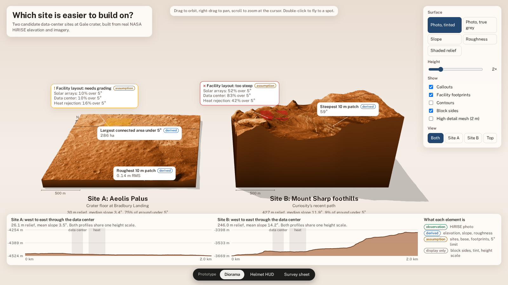
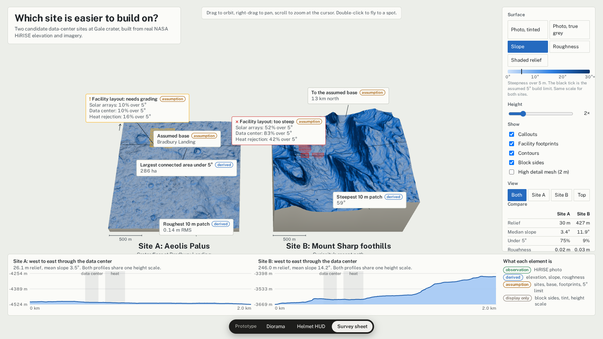
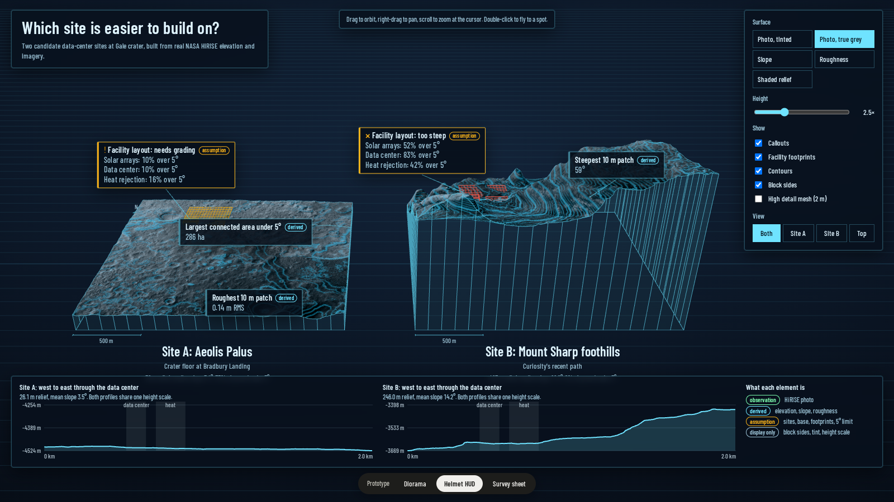

# 3D map prototype: diorama, survey sheet and helmet HUD

A working prototype of how the map shows a candidate data-center site in 3D. It puts two Gale crater
sites side by side as terrain blocks, built from real NASA/JPL Mars Trek data:

- the 1 m HiRISE elevation model (`Gale_DEM_SMG_1m`);
- the HiRISE photo mosaic (`curiosity_hirise_mosaic`, 0.64 m per pixel).

The same scene comes in three looks. Switch between them with the bar at the bottom of the page, or
with `?v=diorama`, `?v=survey` or `?v=hud` in the URL.

It is a prototype: no tests and minimal error handling. The map app (`web/` on the
`feat/site-explorer-map` branch) rebuilds these pieces properly.

## The three looks

### Diorama (`?v=diorama`)



- Each site is a block of terrain, draped with the HiRISE photo tinted to Mars colour.
- The block has solid sides and casts a soft shadow.
- Callouts name the facility fit, the largest flat area, and the steepest and roughest patches.
- Footprints are white where the layout fits, amber where it needs grading and red where it's too steep.

The map's **Lift out as diorama** button on the site card, and **Compare** (two sites side by side on one
height scale), use this look.

### Survey sheet (`?v=survey`)



- A light, print-like sheet.
- Terrain is coloured by slope on a blue ramp, with a black tick at the assumed 5° build limit.
- 10 m contours, and the camera is steeper.
- A **Compare** table in the side panel lists relief, median slope, share under 5° and roughness for
  both sites.

### Helmet HUD (`?v=hud`)



- A dark, cyan, astronaut-display style.
- The photo is in true grey, with glowing 5 m contours.
- Block sides are drawn as lines, over a grid floor.

It is the visual reference for the first-person walk along the investigation route.

### Shared by all three

- **Surface:** photo (tinted or true grey), slope, roughness or shaded relief.
- **Height exaggeration** slider (default 2×).
- **Show:** callouts, facility footprints, contours, block sides, and a 2 m high-detail mesh.
- **View:** both sites, site A, site B, or from the top.
- A west-to-east elevation profile through each data center, on one shared height scale.
- An evidence chip on every value: observation, derived, assumption or display only.
- Hovering the terrain shows elevation, slope and roughness at the cursor.

## What is real and what is a placeholder

| Element | Status |
|---|---|
| Terrain shape, slope, roughness, profiles | Derived from the 1 m elevation model |
| Photo | Real HiRISE greyscale; "tinted" is a cosmetic colour ramp |
| Site boxes, base, footprint sizes, 5° limit, fit rule (≤5% steep = fits, ≤25% = needs grading) | Placeholders, not agreed requirements |
| Block sides, height exaggeration | Display only, not subsurface data |

Known limits:

- The 5 m roughness sits near the elevation model's noise floor (median about 0.02 m at both sites), so
  slope does most of the work.
- Boulders show up only in the photo, never as 3D shapes.

## Run it

From the repo root, with the repo's Python package (`src/martian_map`) in place:

```sh
python3 -m venv .venv && .venv/bin/pip install numpy pillow requests     # once
.venv/bin/python -I design-reference/map-prototype/prepare.py            # fetch (~7 min, 1 request/s) and build
.venv/bin/python -I design-reference/map-prototype/serve.py              # then open http://127.0.0.1:8765/
```

- `prepare.py` downloads from Mars Trek into `cache/` and writes the browser files to `web/data/`
  (about 38 MB). Neither folder is committed.
- It needs no API keys and talks to Trek hosts only.
- `prepare.py build` rebuilds from the cache without downloading again.
- The page uses ES modules and loads its data with `fetch`, so it has to be served. Opening
  `index.html` straight from disk won't work.
- The server binds to 127.0.0.1 only. To view it from another machine, use an SSH tunnel:
  `ssh -L 8765:127.0.0.1:8765 <host>`.

## Tech stack

This is the stack agreed for the map app. Every library is vendored in `web/vendor/` (unchanged files
plus their licences), so nothing is fetched from a CDN and there is no build step.

| Piece | Version | Licence | In this folder | Used for |
|---|---|---|---|---|
| [three.js](https://threejs.org/) | r170 (npm `three@0.170.0`) | MIT | `web/vendor/three/` | Every 3D view: terrain meshes, lights, shadows, camera |
| three.js addons | r170 | MIT | `web/vendor/three/`: `OrbitControls.js`, `CSS2DRenderer.js`; `addons/`: `GLTFLoader`, `BufferGeometryUtils`, `Pass` | Orbit and zoom, HTML callouts pinned to 3D points; the files 3d-tiles-renderer imports |
| [NASA-AMMOS 3d-tiles-renderer](https://github.com/NASA-AMMOS/3DTilesRendererJS) | 0.5.4 | Apache-2.0 | `web/vendor/3d-tiles-renderer/` | The map's continuous globe, zooming from the whole planet down to a site |
| Public Sans | 400, 600, 700 | SIL OFL 1.1 | `web/vendor/fonts/` | Body text |
| Barlow Condensed | 500, 600 | SIL OFL 1.1 | `web/vendor/fonts/` | Headings and HUD text |
| Plain ES modules and an import map | — | — | `web/index.html` | No framework and no bundler |
| Python 3 standard library | — | — | `serve.py` | Local server on 127.0.0.1 |
| numpy, Pillow, requests | — | — | `prepare.py` | Data preparation only |

How the map app uses this stack:

- **The globe** is a sphere with r = 3,396,190 m, built with 3d-tiles-renderer's
  `GeneratedSurfacePlugin` (EPSG:4326 tiles).
- **Imagery** comes from Mars Trek tiles, loaded straight from the browser (CORS allowed):
  - Viking colour mosaic everywhere;
  - CTX and HiRISE at Gale, tinted to the Viking colour, each kept inside its coverage box;
  - a MOLA shaded-relief toggle.
- **Each site** is a three.js terrain mesh from its 1 m elevation grid, placed in a local east-north-up
  frame and set into the globe surface. It has skirts down to the globe so it doesn't read as a raised slab.
- **This prototype's pieces** are reused in the app:
  - terrain mesh and block sides;
  - callout collision culling and the hover readout;
  - the profile chart and evidence chips;
  - the palette.

The prototype's import map only needs `three`. 3d-tiles-renderer is included so the whole stack is in one
place. To use it, map these in the import map:

- `3d-tiles-renderer/three` and `3d-tiles-renderer/three/plugins` → the `index.*.js` files;
- `three/addons/` → `./vendor/three/addons/`.

Each vendor folder's README has the details.
