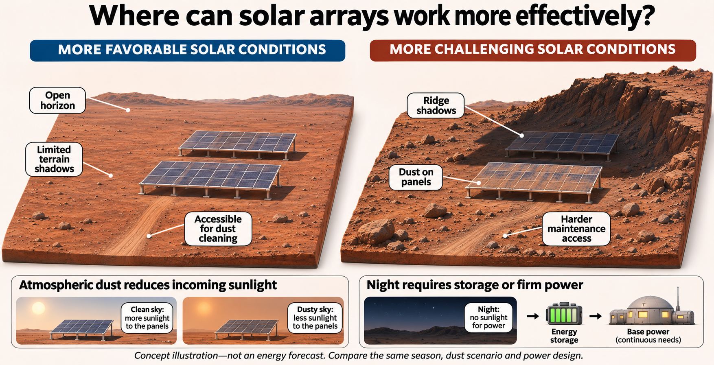

# Solar Conditions Requirements

## Purpose and benchmark status

Evaluate how terrain, illumination, atmosphere and dust affect the supplemental solar system for the [reference facility](REFERENCE_FACILITY.md). Determine useful energy, time-dependent shortages, maintenance needs, and measurements required to compare candidate array plots.

The reference facility proposes 100/225/350 kW low/expected/peak total loads, a firm base-power connection, and a 100 kW average solar sensitivity target. These are assumptions, not validated demand or available capacity. Essential load, firm allocation and storage are unresolved. Solar alone is not assumed to supply the facility continuously.

**Baseline** is the minimum for the chosen screening scenario. **Ideal** adds useful margin. **D** denotes a design-dependent requirement; **P** denotes a proposed project target. All numerical preferences and margins below are provisional, not NASA energy standards. An unmodeled power deficit or unknown input must remain unresolved.

## Illustration

The main panels compare placement, not actual weather at two sites. Atmospheric dust can affect both sites; an open horizon is not protection from a regional storm. The night inset represents the need for storage or firm supply, not a prescribed electrical topology or enough storage for every outage.

## Assessment inputs and conventions

- Specify coordinates, local horizon, terrain model, array orientation/tilt, row layout, panel characteristics, temperature response, and electrical topology.
- Use one common period for comparing sites: initially a complete modeled Martian year for seasonal screening, with repeat-year variability tested separately. Label synthetic years as scenarios, not forecasts.
- Time-tag observations with local solar time and season (solar longitude, Ls). Distinguish irradiance in W/m², energy in kWh, peak power in kW and time-average power in kW. Convert sols to elapsed hours consistently.
- Define nominal seasonal, high atmospheric dust, accumulated panel dust, degraded hardware, and firm-supply-outage cases with their duration and parameter provenance. Do not invent occurrence probabilities.
- Model atmospheric attenuation separately from deposited dust, row/terrain shadows, temperature, conversion and cable losses. Include each loss once; account for diffuse illumination and partial-shading electrical effects.
- Define load schedule, essential services, allowed batch deferral, firm supply, storage energy/power/efficiency, operating bounds and recovery requirements. Use finer time steps around shadows and power transitions; test convergence.

## 1. Illumination and terrain shadows

**What it is:** Sunlight reaching the proposed panel surfaces over the operating period, including obstruction by terrain and array rows.

**Why it matters:** Long or recurring shadows can reduce useful energy even on a generally sunny plain. Clock-hours of daylight do not capture energy lost near high-output periods.

**Measure:** Horizon elevation by azimuth, direct/diffuse plane-of-array irradiance, and energy losses attributable to terrain and row shadows.

| ID and metric | Definition and unit | Baseline benchmark | Ideal benchmark | Evidence |
|---|---|---|---|---|
| SC-01 Terrain-shading energy loss | Difference between unobstructed and terrain-obstructed modeled PV energy divided by unobstructed energy, %; other inputs identical | **P:** ≤ 10% over reference year; seasonal results also reported | **P:** ≤ 5% | Terrain horizon, solar geometry and PV model; local horizon survey |
| SC-02 Row-shading energy loss | Incremental modeled energy loss from actual array rows, %; ordering of loss attribution stated | **D:** ≤ array-design shading allowance | **D/P:** ≤ half that allowance | Layout, array/string model and panel geometry |

**Map output:** Time-dependent shadows, horizon profiles, seasonal energy loss and candidate orientations. A terrain-shadow percentage is not a universal site rejection threshold if an alternate design meets service needs.

**Field measurements:** Survey obstructing horizons and verify light levels at representative array positions. Shadows from nearby structures must be added once layout is defined.

## 2. Useful electrical energy and seasonal performance

**What it is:** Electrical energy actually delivered by the array at a defined connection point.

**Why it matters:** Facility usefulness depends on delivered energy and its timing, not sunlight alone or rated panel capacity under Earth test conditions.

**Measure:** Net generation at array output, cable/inverter losses, degradation and seasonal output. Define the reference meter boundary; storage losses belong to dispatch if output is measured before storage.

| ID and metric | Definition and unit | Baseline benchmark | Ideal benchmark | Evidence |
|---|---|---|---|---|
| SC-03 Average solar contribution | Net PV energy / elapsed hours of the complete reference period, kW | **P:** ≥ 100 kW for the reference solar option | **P:** ≥ 120 kW within the same installed design and land allowance | PV and environmental model calibrated by local test panels |
| SC-04 Worst-season energy adequacy | Minimum delivered PV energy / specified solar-energy requirement across defined seasonal bins | **D:** ≥ 1.0 in every bin with a nonzero requirement | **D/P:** ≥ 1.2 | Seasonal simulation and service/energy requirements |

If solar has no mandatory contribution in a given bin because firm supply meets services, mark that bin's SC-04 ratio not applicable and assess dispatch instead. Failing the 100 kW option does not prove the site unusable with another energy architecture.

**Map output:** Net yield, seasonal profiles, the assumed array size, and uncertainty. Keep model resolution visible; a coarse atmospheric model does not supply metre-scale weather variation.

**Field measurements:** Calibrated irradiance, panel temperature, electrical output and dust measurements; compare test-panel orientation with the modeled design.

## 3. Atmospheric dust, panel soiling and cleaning

**What it is:** Reduced light through dusty air and performance changes from material deposited on panels.

**Why it matters:** These mechanisms differ and require different responses. Cleaning cannot remove atmospheric dust, and average annual yield cannot establish survival through a long storm.

**Measure:** Atmospheric optical-depth history with wavelength and retrieval uncertainty; cleaned/soiled panel output ratios; cleaning effort and recovery.

| ID and metric | Definition and unit | Baseline benchmark | Ideal benchmark | Evidence |
|---|---|---|---|---|
| SC-05 Soiling-loss allowance utilization | Worst modeled deposited-dust energy loss between cleanings / allocated soiling loss | **D:** ≤ 1.0 | **D/P:** ≤ 0.5 | Paired cleaned/soiled panel measurements and maintenance scenario |
| SC-06 Cleaning-resource utilization | Cleaning energy, crew/robot hours and consumables divided separately by their budgets | **D:** Every ratio ≤ 1.0 and access feasible | **D/P:** Every ratio ≤ 0.7 | Local trials, surface properties, equipment plan |

A natural wind-cleaning event is not guaranteed maintenance. Optical depth cannot be converted into surface PV output with an unexplained constant multiplier. High-dust cases must pass essential-service dispatch criteria below or be reported as failing/unresolved.

**Map output:** Distinct atmospheric scenario and surface-soiling layers, cleaning corridors and sensor sites.

**Field measurements:** Monitor both irradiance and deposition; perform representative cleaning tests. Do not generalize one short experiment to all seasons without a model and uncertainty.

## 4. Power continuity, storage and flexible computing

**What it is:** The combined supply's ability to serve loads throughout the time series.

**Why it matters:** The same annual energy can arrive at unusable times. A large annual surplus does not compensate for an essential-service outage.

**Measure:** Time-resolved load, generation, firm allocation, storage charge/discharge and state of charge, essential unserved energy, and completed flexible workload.

| ID and metric | Definition and unit | Baseline benchmark | Ideal benchmark | Evidence |
|---|---|---|---|---|
| SC-07 Unserved essential energy | Integral of unmet essential facility power, kWh, plus outage duration | **D:** 0 in every required scenario | 0 including the agreed additional single-failure stress cases | Validated essential-load and dispatch model |
| SC-08 Storage-limit violations | Count of time steps outside energy, charge/discharge power, temperature or reserve limits | **D:** 0; repeat-period model must not borrow unreplenished initial energy | 0 with the specified extra storage reserve preserved | Storage specifications and chronological dispatch |
| SC-09 Flexible-work completion | Delivered compute work by deadline / required scheduled compute work | **D:** ≥ 1.0 after modeled pauses/restarts | **D/P:** ≥ 1.1 capability at the same power constraints | Workload performance, checkpoint overhead and schedule model |

Maintain a separate remaining-service mode for prolonged outages. The reference facility's 100 kW low-activity allocation is not an established survival load. Thirty-minute ride-through is only a proposed test case; essential load must be defined first. Zero losses in selected scenarios is not a statistical availability guarantee.

**Map output:** Selected plot's dispatch timeline, reasons for shortages, curtailment, and feasible compute schedule. Distinguish site differences from assumed generation/storage choices.

**Field measurements:** Collect inputs for dispatch calibration. A field visit cannot prove long-term power reliability; engineering analysis and system testing remain necessary.

## 5. Array footprint and installation access

**What it is:** Whether the useful energy can be produced within a physically installable and maintainable layout.

**Why it matters:** Required panel area is not the same as land area. Row spacing, anchors, service paths, terrain and electrical routing consume space.

**Measure:** Actual layout fit, panel and plot area, installation corridors and electrical routing.

| ID and metric | Definition and unit | Baseline benchmark | Ideal benchmark | Evidence |
|---|---|---|---|---|
| SC-10 Array layout accommodation | Required panel/support/clearance layout accommodated, % | **D:** 100% within permitted terrain and ground zones | 100% plus specified expansion block | Layout and terrain/ground evidence |
| SC-11 Electrical-route loss | Cable/conversion loss assigned to site connections / defined delivered-energy boundary, % | **D:** ≤ engineering loss allowance | **D/P:** ≤ 0.8 × allowance | Cable length, voltage, current profile, conductor and converter design |

**Map output:** Panel blocks, access and cleaning corridors, support points, connection routes, shading conflicts and exclusion zones. Reference land reserves are adjustable placeholders.

**Field measurements:** Inspect corridors and support ground; verify shadow-casting obstacles. Refer foundation checks to the ground requirements rather than inferring them from solar potential.

## 6. Monitoring and evidence adequacy

**What it is:** Whether observations support the energy model at the intended location and operating conditions.

**Why it matters:** An attractive energy map may rely on sparse seasonal samples or unverified dust and performance assumptions.

**Measure:** Required scenario coverage and the mismatch between model predictions and independent observations.

| ID and metric | Definition and unit | Baseline benchmark | Ideal benchmark | Evidence |
|---|---|---|---|---|
| SC-12 Required scenario coverage | Required seasons, dust cases and operating cases evaluated, % | **D:** 100% before energy-screened acceptance | 100% plus interannual and degradation sensitivity | Scenario register; label measured versus modeled coverage |
| SC-13 Validation-error utilization | Prediction error / defined validation tolerance, with bias and time-profile errors evaluated separately | **D:** Each required error metric ≤ 1.0 | **D/P:** Each ≤ 0.5 | Held-out panel/irradiance observations and uncertainty budget |

**Map output:** Sensor plan, dates, time/season coverage, unvalidated assumptions and next observations.

**Field measurements:** Deploy time-synchronized sensors and test panels, plan monitoring duration and retrieval, and state which seasons remain modeled rather than observed.

## Evidence and decision rules

Every metric carries source, period, location, unit, resolution, uncertainty, model and facility versions, benchmark class, status and next measurement. Use **meets ideal**, **meets baseline**, **fails current target**, **unresolved**, or justified **not applicable**. A ratio with a missing or zero denominator must not be silently computed. Use adverse uncertainty bounds to claim passes; threshold-straddling results remain unresolved. Missing intervals are not zero demand or zero dust.

Evaluate identical scenarios across candidates. No annual energy score may hide essential outages. No ideal solar ranking can cancel unsuitable ground, failed access, or inadequate cooling. Do not describe synthetic scenario outputs as live conditions.

## Validation before adopting benchmarks

1. Define essential load, firm allocation, allowed scheduling, array design and storage.
2. Check common terrain/atmosphere/observation coverage and time conventions.
3. Verify shadow calculations, PV losses and time-step convergence.
4. Test seasonal dust, hardware degradation, restoration and outage cases; calibrate with independent measurements.
5. Review power-system limits and revise provisional targets before feasibility claims.

## Sources and their scope

- [NASA Mars surface-power considerations](https://www.nasa.gov/wp-content/uploads/2024/01/mars-surface-power-generation-challenges-and-considerations.pdf): dust and seasonal constraints; not a solar rating for this site.
- [NASA Mars surface-power decision](https://www.nasa.gov/wp-content/uploads/2024/12/acr24-mars-surface-power-decision.pdf): firm-power architecture context; no guaranteed base allocation.
- [NASA dust accumulation observations](https://science.nasa.gov/photojournal/dust-accumulation-on-mars/): deposition mechanism, not a universal degradation rate.
- [Image prompts and provenance](assets/requirements/IMAGE_PROMPTS.md): conceptual comparison generated with the built-in tool.

The 100/120 kW targets, shading preferences and ideal margins are project proposals, not sourced NASA acceptance limits.
