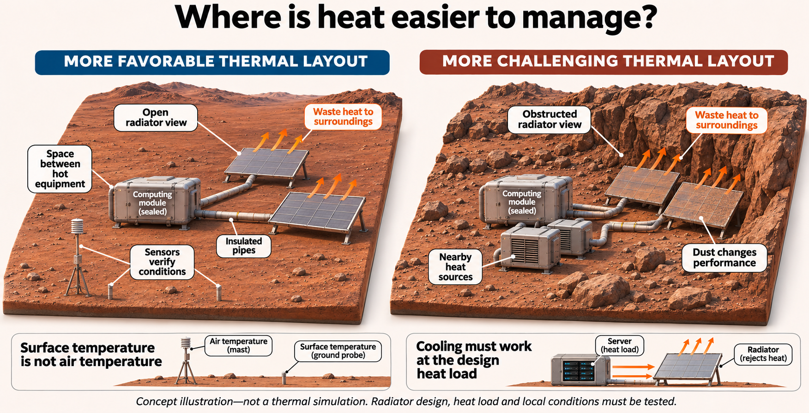

# Thermal Conditions Requirements

## Purpose and benchmark status

Characterize thermal conditions at candidate plots and identify where observations and tests are needed to assess the proposed facility's heat rejection, cold protection and thermal interaction with the ground. This initially supports investigation planning; a temperature map alone cannot establish cooling feasibility.

Use the [reference facility](REFERENCE_FACILITY.md): 60/150/250 kW IT states and 100/225/350 kW total facility allocations. Allocate heat among subsystems before thermal sizing. The 350 kW envelope is an initial whole-facility accounting assumption, not a verified single-loop load. The proposed 1,400–3,500 m² emitting-area sensitivity and 3,000–6,000 m² plot reserve remain unvalidated.

**Baseline** means the minimum condition for the stated thermal scenario; **ideal** adds useful margin. **D** denotes a limit from equipment or engineering design. **P** denotes an adjustable project preference. All numerical ideal margins below are proposed preferences, not NASA limits. A missing temperature limit, heat load, or validated environmental model leaves the relevant result unresolved.

## Illustration

Panels represent heat-rejection equipment, not photovoltaic arrays. Arrows show conceptual heat transfer, not a measured flux or visible plume. The more favorable layout still requires thermal calculations. A cold surface does not establish cold air, an effective radiation sink, or sufficient cooling capacity.

## Assessment inputs and conventions

- Identify surface, subsurface, air, coolant, radiator, enclosure and component temperatures separately, with units, sensor height/depth, date, local solar time and season.
- Define heat dissipation and operating/standby/survival limits for every subsystem, including pumps, converters, heaters and environmental control. Avoid double-counting electrical input and heat loads.
- Specify enclosure environment, coolant properties and pressure, freeze/boil margins, radiator temperature, optical properties, orientation, pipe insulation and design-life degradation.
- Construct hot, cold, startup, shutdown, dust, low-load and required failure cases. Test coincident conditions rather than combining unrelated worst values without explanation.
- For radiators, include emitted and absorbed radiation, sunlight, atmospheric/ground radiation, nearby surfaces and relevant convection/conduction. Mars is not a zero-temperature vacuum. Do not equate clear geometric sky view with a known radiative sink temperature.
- Use kelvin in radiative calculations. A simplified `epsilon × sigma × (T_radiator^4 − T_sink^4)` expression is only valid for its specified view/enclosure assumptions; subtract absorbed external loads consistently and use a full model for heterogeneous surroundings.
- Keep emitting area separate from plot area. Validate small test-panel scaling to the actual geometry and flow system.

## 1. Environmental temperature envelope

**What it is:** The conditions the equipment and thermal system must tolerate over time.

**Why it matters:** One orbital image is a snapshot at a particular local time. It cannot describe the complete day/night, seasonal, or unusual-condition envelope.

**Measure:** Surface, air and depth temperatures, pressure, wind where relevant, extremes, changes over time, and uncertainty of modeled cases.

| ID and metric | Definition and unit | Baseline benchmark | Ideal benchmark | Evidence |
|---|---|---|---|---|
| TC-01 Environmental case coverage | Required thermal cases with a bounded, time-dependent environmental input set, % | **D:** 100% before thermal-screened acceptance | 100%, with independent observations spanning key modeled regimes | Orbital observations, local monitoring and labeled environmental models |
| TC-02 Enclosure external-envelope margin | Minimum distance of predicted external conditions from the qualified enclosure/environmental-control envelope, in the applicable units | **D:** ≥ 0 for every specified limit | **D:** ≥ design-specified extra margin | Enclosure specification, local environmental profile and uncertainty |

**Map output:** Observation footprints and times, separate temperature types, modeled extremes and gaps, and monitoring locations. An unobserved season must be shown as modeled or unknown.

**Field measurements:** Calibrated shielded air sensors at known heights, surface-temperature observations, depth probes, and meteorological measurements. Instrument exposure and heating biases must be characterized.

## 2. Heat rejection and equipment operating temperatures

**What it is:** Whether the proposed thermal system can remove heat while maintaining equipment within its limits.

**Why it matters:** High IT capacity is unusable if cooling cannot support it. Ambient cold does not establish the necessary heat transfer.

**Measure:** Net rejection capacity at allowable operating temperatures, subsystem heat loads, coolant flow and temperatures, and component temperatures under coupled operating cases.

| ID and metric | Definition and unit | Baseline benchmark | Ideal benchmark | Evidence |
|---|---|---|---|---|
| TC-03 Heat-rejection adequacy | Lower-bound available net rejection / required heat load for each loop and case | **D:** ≥ 1.0 at permitted coolant/component temperatures | **D/P:** ≥ 1.2 without exceeding the same limits | Thermal model, specified geometry/flow, instrumented test |
| TC-04 Operating-temperature margin | Minimum of upper allowable minus predicted upper-bound temperature and predicted lower-bound minus lower allowable, °C or K difference | **D:** ≥ 0 for each applicable component and operating case | **D:** ≥ specified extra thermal margin | Component specifications and coupled thermal predictions |

Do not increase assumed radiator temperature beyond allowable coolant or equipment limits to manufacture capacity. Account for any heat exchanger or heat pump temperature differences, energy consumption and failure modes. Evaluate zero-load cases as cold-protection cases rather than dividing by zero in TC-03.

**Map output:** Feasible radiator zones under a named design, capacity ranges, limiting cases, and sensor/test locations. No temperature-only cooling score.

**Field measurements:** Instrumented radiator coupons or panels, heat input, flow, temperatures, net rejection and weather. Ground tests alone do not qualify the complete cooling system.

## 3. Cold protection and thermal cycling

**What it is:** Protection during low loads, shutdown, startup, and repeated changes in temperature.

**Why it matters:** A location favorable for rejecting heat at full load may increase heater demand or expose fluids and equipment to damaging cold conditions when computing pauses.

**Measure:** Minimum equipment/fluid temperatures, freeze margins, heater power/energy, temperature ramp rates and cycle counts.

| ID and metric | Definition and unit | Baseline benchmark | Ideal benchmark | Evidence |
|---|---|---|---|---|
| TC-05 Cold-protection resource utilization | Required heater power and energy divided separately by available allocations in each survival/startup case | **D:** Both ≤ 1.0 while all survival limits hold | **D/P:** Both ≤ 0.8 | Transient thermal model, survival loads and firm supply/storage scenario |
| TC-06 Thermal-cycle utilization | Maximum ramp rate, temperature excursion and life-cycle count divided separately by qualified limits | **D:** All applicable ratios ≤ 1.0 | **D/P:** All ≤ 0.8 | Material/component qualification envelope and transient model |

The reference facility has no established minimum survival load. Passing expected-operation cooling does not resolve shutdown survival or restart. Avoid assuming a single material temperature limit applies to seals, electronics, batteries and coolant.

**Map output:** Cold-sensitive zones, low-load scenarios, heater needs and unresolved survival cases.

**Field measurements:** Monitor full diurnal cycles and selected seasonal regimes, test insulation and cold-start concepts under controlled conditions, and record conditions beyond current evidence.

## 4. Radiator placement, radiation exchange and dust

**What it is:** How local geometry, neighboring equipment, sunlight and surface condition affect heat rejection.

**Why it matters:** Nearby warm surfaces, restricted views, deposited dust, or mutual radiation between panels can change performance. Open sky is helpful only within a complete thermal design.

**Measure:** View factors, solar exposure, temperatures of viewed surfaces, radiator optical properties, soiling state, cleaning access and occupied plot geometry.

| ID and metric | Definition and unit | Baseline benchmark | Ideal benchmark | Evidence |
|---|---|---|---|---|
| TC-07 Adverse-environment rejection penalty | Modeled reduction in net rejection relative to specified reference exposure divided by allocated penalty | **D:** ≤ 1.0 and TC-03 still passes | **D/P:** ≤ 0.5 | Terrain/structure geometry and radiative/thermal model |
| TC-08 Thermal-layout accommodation | Required radiator/support/clearance/maintenance layout accommodated without violating modeled thermal constraints, % | **D:** 100% | 100% plus the specified modular expansion layout | Equipment layout, environmental model and terrain/ground constraints |

Model dust effects on both solar absorption and thermal emission; do not assume a universal fixed loss or beneficial effect. Any advantage from terrain shading must be balanced against obstructed thermal views and other constraints. Solar arrays and radiators may prefer different placements.

**Map output:** Radiator orientations, view obstruction, sun-exposure scenarios, nearby heat-source conflicts, cleaning routes and expansion areas.

**Field measurements:** Verify horizon and nearby surface geometry; measure representative optical/thermal degradation and cleaning recovery using suitable test surfaces.

## 5. Connections and ground thermal interaction

**What it is:** Heat transport between modules and radiators, and the resulting interaction with surrounding ground and infrastructure.

**Why it matters:** Long connections can increase pumping, insulation and freeze-protection demands. Heat leaking into ice-bearing ground can affect stability.

**Measure:** Pipe lengths/elevations, pressure drop, pumping energy, leakage of heat to surroundings, ground temperatures and predicted movement.

| ID and metric | Definition and unit | Baseline benchmark | Ideal benchmark | Evidence |
|---|---|---|---|---|
| TC-09 Connection-resource utilization | Required pump power, pressure head and unwanted thermal exchange divided separately by design budgets | **D:** All applicable ratios ≤ 1.0 with adequate flow and fluid margins | **D/P:** All ≤ 0.8 | Hydraulic/thermal design and mapped route geometry |
| TC-10 Ground-interaction utilization | Predicted thermally induced ground displacement / applicable foundation or utility allowance | **D:** ≤ 1.0; unresolved ice interactions prevent a pass | **D/P:** ≤ 0.5 | Coupled ground/thermal model and depth measurements |

TC-10 shares the ground document's GI-07 underlying calculation and must not be treated as independent evidence in a combined score. Temperature-dependent material behavior and sublimation may matter without liquid water.

**Map output:** Coolant-route alternatives, support/insulation assumptions, thermal influence volumes and ground-monitoring points.

**Field measurements:** Ground profiles, thermal properties and route geometry; cross-reference [ground and ice requirements](GROUND_AND_ICE_REQUIREMENTS.md).

## 6. Monitoring and model verification

**What it is:** The observations and tests needed to distinguish an appealing concept from a supported thermal assessment.

**Why it matters:** A few surface pixels cannot establish conditions at every equipment pad or validate a radiator design.

**Measure:** Completion of a location/time/depth monitoring plan and out-of-sample model errors for temperatures and net rejection.

| ID and metric | Definition and unit | Baseline benchmark | Ideal benchmark | Evidence |
|---|---|---|---|---|
| TC-11 Required monitoring completion | Required spatial/time/depth cases supported at specified precision by observations or accepted bounded models, % | **D:** 100% for acceptance; measured and modeled shares shown separately | 100%, with local observations for every decision-critical regime | Monitoring plan, sensor metadata and evidence register |
| TC-12 Model validation utilization | Temperature and heat-rejection prediction errors divided by their respective tolerances | **D:** All required validation metrics ≤ 1.0 | **D/P:** All ≤ 0.5 | Held-out measurements and instrument uncertainty |

**Map output:** Proposed sensor locations, what each resolves, expected duration, power/data needs and revisits. Clearly label simulated test results in a prototype.

**Field measurements:** Independent measurements for calibration and validation, with explicit limitations when adverse or seasonal regimes cannot be observed during the initial mission.

## Evidence and decision rules

Record value, units, location/depth, acquisition time and season, resolution, instrument/model, uncertainty, boundary conditions, facility version, D/P benchmark and next test. Use **meets ideal**, **meets baseline**, **fails current target**, **unresolved**, or justified **not applicable**. Apply adverse uncertainty bounds; missing limits or intervals cannot pass by default.

THEMIS infrared data are approximately 100 m/pixel according to the instrument fact sheet. At that scale, a 60 m core compound may fall within one mixed pixel. Resampling does not reveal separate module temperatures. Orbital thermal evidence helps characterize context; local air, subsurface and equipment measurements answer different questions.

A candidate does not become better simply because its surface is colder. No average temperature or weighted score may hide an equipment-limit exceedance, unresolved survival case, or failure to reject required heat. Evaluate feasible operation and the observations needed to resolve it.

## Validation before adopting benchmarks

1. Allocate subsystem heat and power consistently across operating and survival states.
2. Define equipment, coolant and enclosure limits and environmental boundary cases.
3. Review spatial/time coverage and avoid conflating surface, air and subsurface temperatures.
4. Validate a thermal model with representative tests; test uncertainty, dust, failures and scaling.
5. Review proposed margins and layout with thermal/ground engineering expertise before feasibility claims.

## Sources and their scope

- [THEMIS fact sheet](https://themis.asu.edu/factsheet): surface thermal sensing and infrared resolution; no equipment cooling-capacity guarantee.
- [NASA Mars power and heating overview](https://science.nasa.gov/wp-content/uploads/2024/02/mars-power-heating.pdf): environmental and thermal-control context.
- [NASA Mars science objectives](https://science.nasa.gov/planetary-science/programs/mars-exploration/mars-science-objectives/): ground/ice and environmental context.
- [Image prompts and provenance](assets/requirements/IMAGE_PROMPTS.md): built-in image-generation tool, conceptual illustration.

The design ratios, heat-load scenarios and ideal margins are project assessment choices, not published acceptance criteria for a Mars data center.
