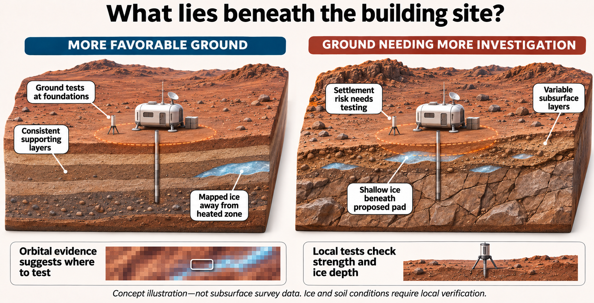

# Ground and Ice Evidence Requirements

## Purpose and benchmark status

Evaluate whether the subsurface can support the reference computing facility, its equipment foundations, and service corridors, and identify the field tests needed to resolve geological and ice-related uncertainty. Surface geometry is covered separately by [Buildable Terrain Requirements](buildable-terrain.md).

Use the [reference facility](../reference-facility.md): six conceptual equipment/support modules, separate solar and radiator plots, and connecting corridors. Module mass, contact loads, foundation design, and excavation equipment are not yet defined. The site cannot receive a ground-suitability pass until those design inputs and adequate local evidence exist.

**Baseline** is the minimum criterion for the stated screening scenario; **ideal** adds margin or reduces work. **D** denotes a design-dependent engineering limit. **P** denotes a proposed project preference. Every numerical ideal multiplier below is a P preference, not a NASA standard or substitute for a geotechnical safety factor. Missing design limits remain unresolved. A pass is conditional screening evidence, not construction approval.

## Illustration

The cutaways illustrate possible conditions, not actual subsurface observations. Orange boundaries represent a hypothetical influence zone; its real depth and lateral extent require modeling. Ice near a facility is not automatically harmful or useful, and layered ground is not automatically strong. Tests determine the relevant properties.

## Assessment inputs and conventions

- Define loads and contact geometry for modules, arrays, radiators, anchors, trenches, and loaded vehicles. Include applicable lateral, uplift, dynamic, and thermal load cases.
- Set allowable bearing stress, total settlement, differential settlement, anchor displacement, and utility deformation through design. Allowable capacities must already include the selected safety factors and failure mechanisms.
- Define excavation depth and equipment capabilities, the five-Earth-year service-life scenario, and expected facility-to-ground heat transfer.
- Map geological units and uncertainties in three dimensions where possible. Record depth reference, sample coordinates, laboratory conditions, temperature, ice content, instrument sensitivity, and inferred versus measured properties.
- Evaluate normal operation, shutdown, construction disturbance, and the specified adverse thermal cases. Do not infer safe frozen-ground behavior from a single present-day temperature.
- Orbital geological, thermal, and ice products guide investigation. They do not directly provide foundation bearing capacity. Ice-consistency scores are not calibrated probabilities or local ice-volume fractions.

## 1. Supporting material and load capacity

**What it is:** The ability of soil or rock beneath each structure to resist its specified loads.

**Why it matters:** A flat site may contain weak deposits, fractures, or thin crusts over softer material. Different equipment can have very different contact pressures.

**Measure:** Soil density and strength, rock condition, layering, contact pressure, and allowable capacities for each applicable load case.

| ID and metric | Definition and unit | Baseline benchmark | Ideal benchmark | Evidence |
|---|---|---|---|---|
| GI-01 Bearing-capacity adequacy | Minimum allowable bearing stress divided by applied design contact stress, dimensionless | **D:** ≥ 1.0 for every support and applicable case | **D/P:** ≥ 1.25 using the same design method | Local samples/probing and appropriate load tests; geotechnical calculation |
| GI-02 Other support-limit utilization | Maximum demand/allowable capacity across applicable anchor, sliding, uplift, and lateral cases | **D:** ≤ 1.0 in every case | **D/P:** ≤ 0.8 | Material testing, foundation/anchor design and modeled loads |

**Map output:** Support locations, material units, evidence depth, utilization, and untested zones. Show the governing load case rather than an average capacity.

**Field measurements:** Targeted cores, penetration/probing, exposed-rock inspection, and suitable load/anchor tests. Test method and interpretation must suit Mars gravity, confinement, temperature, and the material encountered.

## 2. Settlement and subsurface variability

**What it is:** Absolute movement and uneven movement between supports over time.

**Why it matters:** Differential movement can distort modules, pipes, and cable connections even when total movement is relatively small. Uniform-looking surface material may conceal variable layers.

**Measure:** Layer thickness, compressibility, fracture distribution, support displacement and its evolution under loads and thermal cycles.

| ID and metric | Definition and unit | Baseline benchmark | Ideal benchmark | Evidence |
|---|---|---|---|---|
| GI-03 Total settlement utilization | Upper-bound predicted settlement divided by design allowance, at each support | **D:** ≤ 1.0 through service life | **D/P:** ≤ 0.5 | Local material properties and load/time model; monitoring |
| GI-04 Differential movement utilization | Maximum relative support movement or angular distortion divided by its respective allowance | **D:** All applicable ratios ≤ 1.0 | **D/P:** All ≤ 0.5 | Spatial investigation and structure/utility tolerance model |

**Map output:** Cross-sections, material boundaries, predicted movement ranges, and test locations where alternative subsurface interpretations change the result.

**Field measurements:** Profiles across proposed foundations, tests on both sides of material transitions, and reference markers for repeat surveys. One test at the center of a plot is not automatically representative of all supports.

## 3. Ice location and interaction with construction

**What it is:** Where ice may occur relative to excavation, loaded ground, and the facility's thermal influence.

**Why it matters:** Excavation or heating can alter ice-bearing material. A resource nearby does not establish stable foundations or an available cooling supply.

**Measure:** Ice presence, depth and lateral extent, content where measurable, uncertainty, and overlap with construction/thermal influence volumes.

| ID and metric | Definition and unit | Baseline benchmark | Ideal benchmark | Evidence |
|---|---|---|---|---|
| GI-05 Unresolved ice interactions | Count of critical supports/corridors whose influence volume intersects possible ice without an evaluated response or mitigation | **D:** 0 before ground-screened acceptance | **P:** 0 and no ice-related mitigation needed beneath critical infrastructure | Local survey and coupled ground/thermal assessment |
| GI-06 Investigated depth coverage | Adequately characterized depth divided by required investigation depth, at each designated critical zone | **D:** ≥ 1.0; required horizontal coverage also satisfied | **D/P:** ≥ 1.2 where useful and practicable | Radar constrained by local materials, cores/probes, corroborating methods |

Do not assume a universal safe ice depth. Required depth follows foundation influence, excavation, heat transfer, and instrument detectability. A radar non-detection does not establish absence unless sensitivity at the relevant depth and material conditions is adequate.

**Map output:** Possible versus confirmed ice, depth ranges, supporting observations, influence volumes, and priority investigation locations.

**Field measurements:** Ground-penetrating radar where suitable, targeted depth probes or cores, temperature profiles, and material verification. Account for ambiguity and penetration limits.

## 4. Stability under heating and seasonal change

**What it is:** Ground response to seasonal conditions, construction exposure, and heat introduced by the facility.

**Why it matters:** Warming or sublimation can change properties even without liquid water. Stable current conditions do not establish stable future conditions.

**Measure:** Ground temperature by depth, thermal properties, modeled changes in ice/material structure, and resulting deformation.

| ID and metric | Definition and unit | Baseline benchmark | Ideal benchmark | Evidence |
|---|---|---|---|---|
| GI-07 Thermally induced deformation utilization | Upper-bound predicted displacement from thermal/ice changes divided by its design allowance | **D:** ≤ 1.0 in all required construction and operating cases | **D/P:** ≤ 0.5 | Ground profiles, thermal boundary conditions and material-response model |
| GI-08 Unassessed influence overlap | Critical foundation/utility area overlapping an unassessed ground-change envelope, m² | **D:** 0 | 0 including optional expansion footprints | Coupled models and monitored calibration data |

Do not simply add separate settlement predictions if they double-count the same physical mechanism. Evaluate combined load and thermal response consistently.

**Map output:** Heat-influence and ground-change envelopes by time, sensitive interfaces, and monitoring locations. Cross-link to [thermal requirements](thermal-conditions.md).

**Field measurements:** Deploy depth-temperature sensors and displacement references; monitor over relevant cycles. A brief excursion can install instruments but cannot measure five years of behavior.

## 5. Excavation and material handling

**What it is:** How the actual soil, rock, and ice affect preparing supports and installing utilities.

**Why it matters:** Terrain-volume estimates do not tell us whether equipment can excavate the material, whether exposed ground remains stable, or whether excavated material can be reused.

**Measure:** Material strength and abrasiveness, excavation energy and rate, handling mass, and stability of intended excavations.

| ID and metric | Definition and unit | Baseline benchmark | Ideal benchmark | Evidence |
|---|---|---|---|---|
| GI-09 Construction-budget utilization | Required excavation energy, machine-hours and handling mass divided separately by their budgets | **D:** Every ratio ≤ 1.0 and all operations within equipment capability | **D/P:** Every ratio ≤ 0.7 | Representative trial, sampled properties, proposed works |
| GI-10 Unresolved excavation stability cases | Count of proposed excavations without an assessed stable/supportable configuration | **D:** 0 | **P:** 0 without special ground treatment beyond standard scenario equipment | Geotechnical analysis and field inspection |

**Map output:** Excavation zones by material, work estimates, handling destinations, and locations requiring special methods. Do not automatically treat spoil as usable fill or shielding.

**Field measurements:** Small controlled trials where justified, sample testing, and inspection of material transitions. Applicable mission sampling and disturbance constraints remain inputs.

## 6. Evidence coverage and investigation value

**What it is:** Whether evidence actually resolves the ground questions that determine site selection.

**Why it matters:** A visually detailed map can conceal coarse or indirect subsurface information. Better-looking evidence is not necessarily more decisive.

**Measure:** Completed evidence requirements in a geotechnical investigation plan and uncertainty around threshold-sensitive predictions.

| ID and metric | Definition and unit | Baseline benchmark | Ideal benchmark | Evidence |
|---|---|---|---|---|
| GI-11 Critical-zone evidence completion | Share of required foundation/corridor zones with the specified spatial/depth characterization, % | **D:** 100% before ground-screened acceptance | 100%, plus corroboration for each decision-critical indirect inference | Sampling plan and evidence register |
| GI-12 Decision-critical unresolved hypotheses | Count of plausible material/ice interpretations that could reverse acceptance and have not been resolved or bounded | **D:** 0 for acceptance; otherwise an investigation candidate | 0, with site ordering unchanged across justified parameter ranges | Sensitivity analysis and field results |

**Map output:** Test priorities linked to decisions, method, required precision/depth, and expected result. This is the primary initial product when engineering or field evidence is incomplete.

**Field measurements:** Assign methods to the uncertainty, not arbitrary equal spacing. Robots may collect the data; crew presence is not inherently required.

## Evidence and decision rules

Record metric ID, zone, value, unit, source, date, depth and spatial support, uncertainty, model version, design inputs, benchmark class, status, and next measurement. Use **meets ideal**, **meets baseline**, **fails current target**, **unresolved**, or **not applicable with justification**. Use upper uncertainty bounds for maximum limits and lower bounds for minimum capacities; threshold-straddling results remain unresolved. Never turn an unknown into a zero or cancel a critical failure with an average score.

SWIM products described by USGS include approximately 3 km ice-consistency pixels. Such evidence can guide regional selection but cannot resolve ice beneath an individual support pad. Coverage and local applicability remain to be checked. Mineral spectra and thermal inertia likewise do not directly establish soil strength.

## Validation before adopting benchmarks

1. Specify loads, foundations, excavation methods, depth of influence and service-life cases.
2. Check co-located data coverage and distinguish direct observations from inference.
3. Design local tests with required precision and representative spatial/depth coverage.
4. Test sensitivity to alternate geological interpretations and heating scenarios.
5. Review capacities and movement allowances with relevant engineering expertise before construction claims. Recalculate after mitigation or layout changes.

## Sources and their scope

- [NASA Mars science objectives](https://science.nasa.gov/planetary-science/programs/mars-exploration/mars-science-objectives/): context for ice, surface science and infrastructure concerns, not foundation thresholds.
- [USGS refined subsurface ice mapping](https://www.usgs.gov/publications/refined-mapping-subsurface-water-ice-mars-support-future-missions): scale and uncertainty of regional ice products.
- [SWIM data products](https://swim.psi.edu/SWIM2Products.php): combined ice-consistency evidence, not calibrated foundation-scale probabilities.
- [Image prompts and provenance](images/image-prompts.md): built-in image-generation tool; concept illustration only.

All baseline design ratios and ideal margins are project assessment definitions. Sources do not certify a Mars data-center design.
