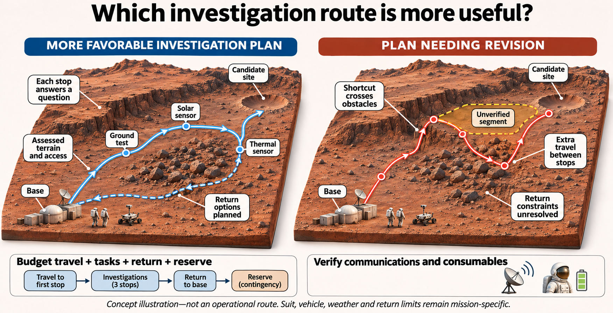

# Investigation Routes Requirements

## Purpose and benchmark status

Plan useful surface investigations of candidate facility sites: where to go, what to measure, in what order, and how to return within a stated mission envelope. Support comparison and evidence gathering, not operational certification of astronaut safety.

Use the [reference facility](../reference-facility.md) and its hypothetical base. Its approximately 1–3 km candidate search distance is a planning assumption, not a walking range or approved excursion limit. Define walking, rover-assisted, and robotic plans separately. A route suitable for an astronaut is not automatically a heavy-cargo route.

**Baseline** is the minimum condition for a scenario-feasible investigation plan. **Ideal** adds information value or reserve. **D** denotes a limit from mission/suit/vehicle/instrument design. **P** denotes a proposed project preference. Numerical margins below are comparison choices, not NASA EVA limits. No fixed oxygen duration, radiation allowance, or safe travel distance is invented. Missing mission limits leave route feasibility unresolved.

## Illustration

Routes, base, instruments and astronauts are conceptual. The blue line is not a verified safe path, and a dashed alternate is not automatically independent or reachable. Real direction, timing, task duration, resource consumption and contingencies must be evaluated together. The illustration does not locate a real facility.

## Assessment inputs and conventions

- Define crew or robot count, walking/vehicle modes, payload, available instruments, mission date and time, and base/shelter locations and capabilities.
- Specify suit/vehicle limits, consumable capacities and reserves, mobility on each terrain class, task duration distributions, communication rules, weather/exposure constraints and return policy. Ground material and traction are separate from geometric slope.
- Define mandatory questions and measurements, optional stops, expected result precision, instrument reach/depth, contamination controls and dependencies.
- Model routes as directed time-dependent segments: outward and return speed/energy may differ. Include travel between all stops, setup, measurement, packing, delays and return. Include contingency reserves without counting them twice.
- Use mission-supported time/resource bounds. Do not imply a numerical probability of safe completion without calibrated distributions and validated correlations.
- Local navigation and base communications must function under the assumed architecture. Do not assume a Mars GPS service or immediate intervention from Earth.

## 1. Investigation purpose and measurement value

**What it is:** The decision each stop can inform and the measurement capable of informing it.

**Why it matters:** Visiting many locations is not valuable if the measurements cannot change the site assessment. Some hypotheses require multiple depths, positions or seasons.

**Measure:** Traceability from stops to uncertainties, required method and precision, and coverage of the declared excursion objectives.

| ID and metric | Definition and unit | Baseline benchmark | Ideal benchmark | Evidence |
|---|---|---|---|---|
| IR-01 Stop-to-decision traceability | Stops with a named hypothesis, method, required precision and decision consequence / planned stops, % | **D:** 100% | 100%, with redundant stops removed unless scientifically justified | Investigation plan linked to ground, solar and thermal metric IDs |
| IR-02 Mandatory objective coverage | Mandatory measurement objectives achievable in this excursion / declared mandatory objectives, % | **D:** 100%, or revise scope before acceptance | 100% plus highest-value optional objectives without using mandatory reserves | Task/instrument plan, route and resource model |

Objectives requiring seasonal monitoring count as deployment objectives only; deployment does not equal completed seasonal evidence. A narrower valid excursion can form part of a multi-excursion program.

**Map output:** Numbered stops with question, method, expected duration, required equipment, and site-selection consequence.

**Field measurements:** Record location/depth/time, instrument calibration, achieved precision, deviations and findings. Failed or inconclusive tests remain unresolved rather than counted as answered questions.

## 2. Terrain access and mobility

**What it is:** Whether the selected crew/vehicle can traverse every route segment under the modeled conditions.

**Why it matters:** Shortcuts can cross slopes, steps or weak material that make a route unusable. A route must work in both directions with its actual payload.

**Measure:** Segment slopes and cross-slopes, obstacles, clearance, traction/ground evidence and mode-specific mobility utilization.

| ID and metric | Definition and unit | Baseline benchmark | Ideal benchmark | Evidence |
|---|---|---|---|---|
| IR-03 Mobility-limit utilization | Maximum demand/limit across each relevant grade, cross-slope, step, clearance or ground parameter; formulate ratios so ≤ 1 is acceptable | **D:** Every applicable ratio ≤ 1.0 on outward and return paths | **D/P:** Each ≤ 0.7 where meaningful; otherwise use a design-defined margin | Terrain/ground evidence plus mode/payload-specific capabilities |
| IR-04 Assessed route coverage | Route length with sufficient evidence for all critical mobility checks / total required route length, % | **D:** 100% for a scenario-feasible crewed route | 100% plus the required alternate-return segments | Segment evidence register and targeted reconnaissance |

Unverified segments can appear in a reconnaissance proposal, but they prevent a complete crew-route feasibility pass. Do not erase a short unknown obstacle by averaging coverage over a long route.

**Map output:** Segment conditions, direction, mode, evidence resolution, bottlenecks and reconnaissance needs.

**Field measurements:** Close-range geometry, traction/sinkage observations and robot reconnaissance where appropriate. Link construction-scale access to BT-17 through BT-20 without treating its vehicle assumptions as suit limits.

## 3. Timeline and return feasibility

**What it is:** Whether travel, work, return and required contingencies fit the time window.

**Why it matters:** A route can fit a distance limit but take too long after instrument setup or difficult terrain. Return feasibility must remain valid as the excursion progresses.

**Measure:** Bounded task and travel times, remaining mission time, and return duration from each relevant route position and task state.

| ID and metric | Definition and unit | Baseline benchmark | Ideal benchmark | Evidence |
|---|---|---|---|---|
| IR-05 Planned-time utilization | Upper planning estimate of travel + tasks + return divided by available duration after required contingency reserve | **D:** ≤ 1.0 | **D/P:** ≤ 0.8 | Mode-specific travel model, task trials and mission window |
| IR-06 Return-time feasibility | Worst-case assessed return time / remaining allowed time after required return contingency, evaluated along route | **D:** ≤ 1.0 at every evaluated state; intervening changes bounded | **D/P:** ≤ 0.8 | Dynamic route timeline, return paths and updated progress |

Return is already part of IR-05 planned time; do not add it twice. For IR-06, evaluate from the current state, including time to stop work and make equipment/crew ready to move. A nonpositive denominator means no feasible continuation.

**Map output:** Arrival/task/departure times, turnaround points, alternative stop sequences and latest permissible departure from each stop.

**Field measurements:** Compare actual travel and task times with predictions, revise the plan when conditions change, and flag uncertainty beyond model assumptions.

## 4. Consumables, payload and instruments

**What it is:** Whether the excursion can be completed with the available resources and required equipment.

**Why it matters:** Oxygen, battery energy, CO₂ removal, thermal-control resources, instrument power, storage and payload can impose different limits. A single battery bar is insufficient.

**Measure:** Resource consumption by travel/work mode, task and return requirements, reserves, payload mass/volume, and instrument performance.

| ID and metric | Definition and unit | Baseline benchmark | Ideal benchmark | Evidence |
|---|---|---|---|---|
| IR-07 Resource utilization | Required quantity / usable quantity after prescribed reserve, separately for every limiting consumable | **D:** All ≤ 1.0 including return and required contingency cases | **D/P:** All ≤ 0.8 | Suit/vehicle/instrument models calibrated to activities and conditions |
| IR-08 Return-resource feasibility | Required quantity to terminate work and return / available remaining quantity after prescribed reserve, per resource along route | **D:** All ≤ 1.0 at every evaluated state | **D/P:** All ≤ 0.8 | Time-dependent consumption and return model |
| IR-09 Instrument and payload readiness | Mandatory tasks with deployable equipment meeting precision/depth/range, mass, volume, power and data constraints, % | **D:** 100% | 100% plus the specified backup method for decision-critical tasks | Instrument specifications, test results and packing/deployment plan |

Mission reserves are authoritative inputs; the extra 20% ideal headroom is only a proposed comparison preference and must not replace them. Instruments requiring long-term monitoring need an independent post-deployment power/data/retrieval plan.

**Map output:** Limiting resource, projected state at each stop, task equipment, deployment locations and return triggers.

**Field measurements:** Record activity-dependent use and instrument performance. Synthetic telemetry must be labeled simulated; no live suit integration is assumed.

## 5. Communications, navigation and environmental exposure

**What it is:** Ability to locate the crew, exchange required information locally, and operate within mission environmental limits.

**Why it matters:** Terrain can block communications and landmarks; lighting and weather can change route usability. Earth communications cannot substitute for local timely support.

**Measure:** Terrain/link geometry and modeled link margins, communication gap durations, localization uncertainty, weather/visibility and cumulative exposure.

| ID and metric | Definition and unit | Baseline benchmark | Ideal benchmark | Evidence |
|---|---|---|---|---|
| IR-10 Longest unsupported communication interval | Maximum interval without mission-required local communication, minutes | **D:** ≤ mission allowance, with assessed recovery procedure | **P:** 0 where continuous local coverage is practicable | Terrain, antenna/relay design, schedule, link budget and field checks |
| IR-11 Navigation-error utilization | Position-error bound / allowable error for the local obstacle corridor or measurement task | **D:** ≤ 1.0 | **D/P:** ≤ 0.5 | Navigation architecture, reference landmarks, survey and localization tests |
| IR-12 Environmental-limit utilization | Exposure or environmental demand / respective allowance, evaluated separately; report temperature limits as margins where ratios are inappropriate | **D:** All limits met with uncertainty accounted for | **D:** All limits plus mission-defined extra margins met | Mission-time weather/radiation/visibility scenarios, sensors and policy inputs |

Line of sight is not proof of a functioning communication link. Dose, temperature, wind and visibility are different quantities and must not be combined into a single unexplained score. Do not invent medical limits or assume rover measurements at another site provide a local real-time hazard forecast.

**Map output:** Coverage and navigation gaps, time-dependent exposure/lighting, relevant shelters and conditions requiring plan revision.

**Field measurements:** Local communication tests, position checks, environmental monitoring and instrument deployment. Record representativeness and whether inputs are historical or modeled.

## 6. Alternatives, contingency and evidence updates

**What it is:** Whether the plan remains workable under its specified disruptions and adapts to new evidence.

**Why it matters:** A blocked passage, vehicle failure, delayed measurement or failed instrument can invalidate a previously acceptable route. A shelter icon is not evidence of usable shelter.

**Measure:** Completion of defined contingency evaluations and the independence and feasibility of alternate return arrangements.

| ID and metric | Definition and unit | Baseline benchmark | Ideal benchmark | Evidence |
|---|---|---|---|---|
| IR-13 Required contingency coverage | Defined disruption cases with assessed return/shelter/support response meeting limits, % | **D:** 100% | 100% plus agreed additional stress cases | Mission scenario set including blocked route and vehicle failure where applicable |
| IR-14 Independent return options | Assessed return options without shared critical failure, available from each designated critical stop | **D:** ≥ 1 satisfying the contingency policy | **P:** ≥ 2 where geography permits | Route graph, common-failure review, resources and shelter capabilities |

A second drawn line is not an independent option if both cross the same bottleneck or rely on the same failed vehicle. Walking home after a rover failure must be demonstrated within mission limits, not assumed. Rescue assets, response times and shelter capacity are scenario inputs.

**Map output:** Alternate routes and shared chokepoints, contingency cases, decision triggers, updated evidence and revised stop priorities.

**Field measurements:** Verify shelter/access assumptions and compare actual conditions with the plan. Recompute remaining time/resources after each significant change rather than following a fixed route regardless of evidence.

## Evidence and decision rules

Each route/segment/stop stores objective, ID, coordinates, direction, transport mode, source/date, resolution, uncertainty, time/resource model, facility and mission versions, D/P benchmark, status and next check. Use **meets ideal**, **meets baseline**, **fails current target**, **unresolved**, or justified **not applicable**. Distinguish a reconnaissance concept from a fully assessed scenario-feasible route.

All critical criteria must pass for route feasibility under the stated scenario. Unknown segments, resource limits or contingencies remain unresolved. Information value never offsets a failed return constraint. Use adverse uncertainty bounds; retain task/travel correlations when supported. Offline map availability and version consistency are required for the prototype's assumed disconnected-use mode, but no operational navigation certification is implied.

The route serves the investigation: unresolved ground, solar and thermal metrics should generate targeted stops. Not every uncertainty can be resolved during one excursion. Clearly show deployment, measurement, laboratory analysis and later monitoring as separate stages.

## Validation before adopting benchmarks

1. Define the mission mode, instruments, serviceable base/shelters, consumables and limits.
2. Ground each stop in a decision-critical question and verify method suitability.
3. Check terrain evidence and simulate the full directed timeline with pauses, setup, return and reserves.
4. Test blocked routes, slow progress, instrument faults, communications loss and relevant vehicle contingencies.
5. Validate models using suitable trials and engineering/mission review before operational use; keep the challenge prototype explicitly scenario-based.

## Sources and their scope

- [NASA-hosted EVA decision-support research](https://ntrs.nasa.gov/api/citations/20230007488/downloads/ICES%202023%20PersEIDS.pdf): context for consumables, timeline replanning and delayed Earth support, not approved Mars excursion limits.
- [HiRISE terrain-model documentation](https://www.uahirise.org/dtm/about.php): terrain evidence and its resolution limitations.
- [Challenge objectives](https://www.spaceappschallenge.org/2026/challenges/interplanetary-survival-guide-martian-map/?tab=details): localized astronaut exploration and integrated data.
- [Image prompts and provenance](images/image-prompts.md): conceptual comparison generated with the built-in tool.

All proposed margins and plan-completeness metrics are project definitions. Operational limits must come from a specified mission, not from the illustration or the prototype.
